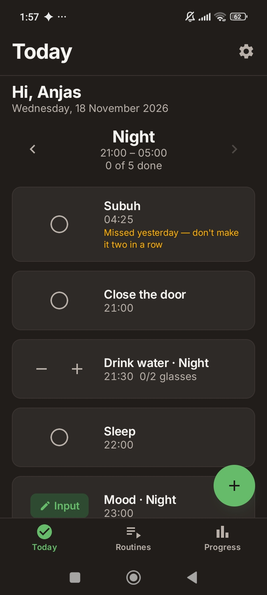
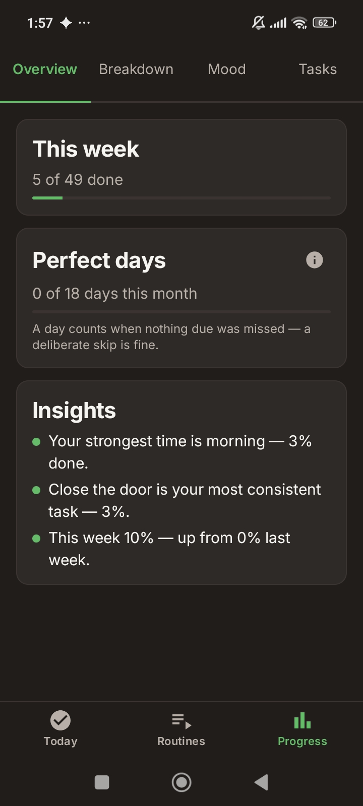
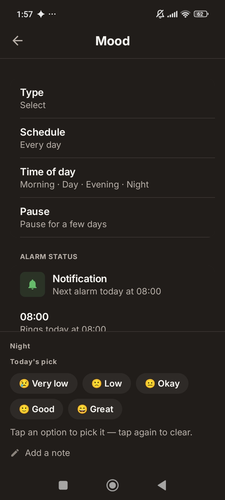
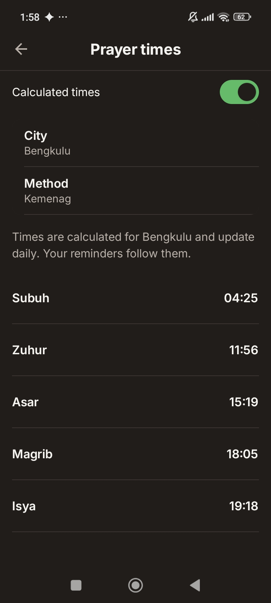
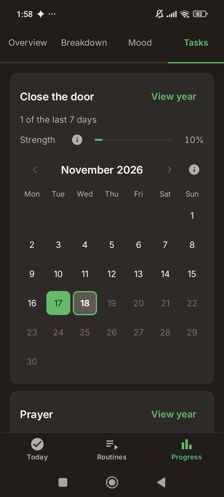

# Daily Log — Public Releases

**Daily Log** is an offline Android app for daily reminders and a private journal — built for people who want gentle structure without accounts, cloud sync, or guilt mechanics. No streaks, no ads, no tracking. Your data stays on your phone.

## Screenshots

   
  <b>Today</b> — Tasks grouped by time of day, one group at a time

   
  <b>Progress</b> — Weekly overview, perfect days, and insights

   
  <b>Mood</b> — Four check-ins a day, with an optional note

   
  <b>Prayer times</b> — Calculated daily for your city; reminders follow

   
  <b>Calendar</b> — Per-task calendar, strength score, and backfill

## Features

- **Daily reminders** — reliable exact alarms for the things that matter: sleep, prayer, reading, meals, and your own habits, with optional nagging repeats and location triggers
- **Prayer times** — all five daily prayers, with computed times for Indonesian cities or your own schedule
- **Private journal** — mood-tagged entries with optional biometric/PIN lock
- **Routines & long tasks** — step-by-step routines with voice guide, and focus timers for longer tasks
- **Progress dashboard** — weekly summaries, per-task calendars, and a Year in Pixels view
- **Home-screen widget** — today's tasks at a glance
- **Private by design** — offline-first, no account, encrypted backup export (JSON/CSV)

## Get the app

Download the latest signed APK from the **[Releases](https://github.com/Anjasfedo/daily-log-releases/releases)** page and install it on your Android phone (Android 8.0 or newer, ±14 MB). Release builds install over previous versions, keeping your data.

## About this repo

This repository contains **only release artifacts** — the source code lives in a private repository. Each release is built here on GitHub Actions by checking out the private source with a read-only deploy key, compiling a signed release APK, and wiping the source from the runner before publishing. No source code is ever committed to this repo.

Builds are triggered manually per release tag (e.g. `v0.15.0-32ea42c`). Release notes come from the private repo's `CHANGELOG.md`.

Built with Kotlin, Jetpack Compose, Room, and Hilt.
